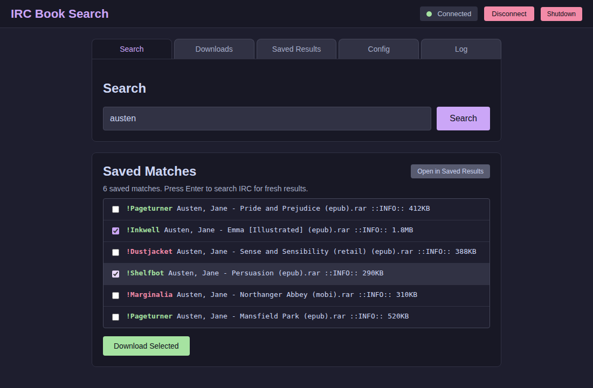
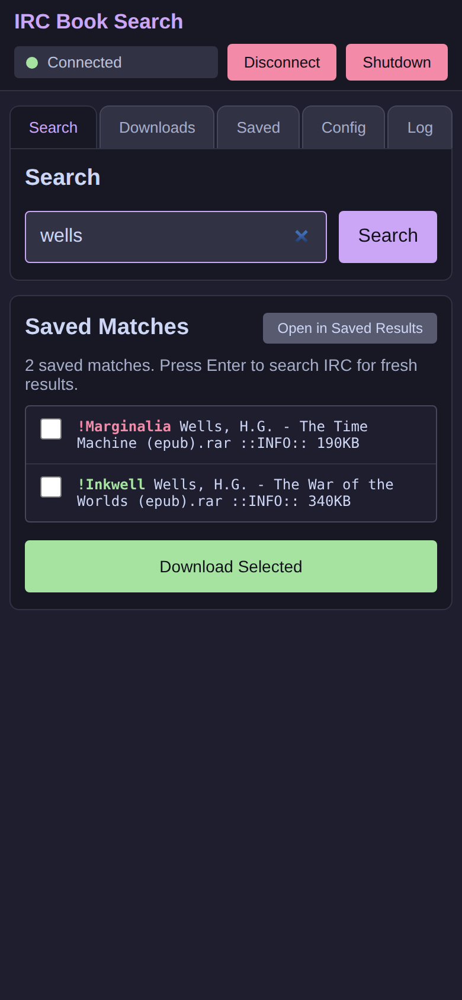
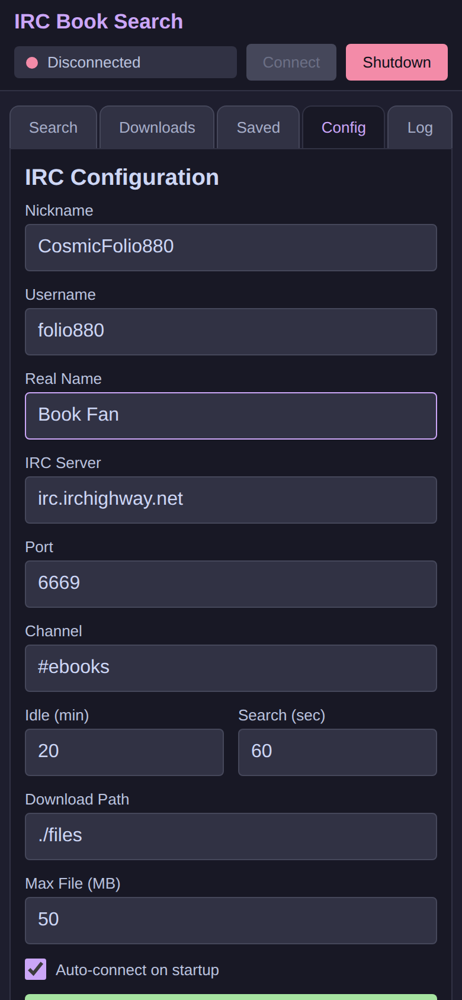

# IRC Book Search

A small web app for searching and downloading ebooks from IRC channels such as
`#ebooks` on IRC Highway. Searches are sent to the channel's search bot, the
results arrive as a DCC file transfer, and you pick what to download from a
browser UI that works on desktop and phone. Downloaded books land in a folder
of your choosing.

Version 2 is a rewrite of the original Python/aiohttp/irc3 app in TypeScript on
[Bun](https://bun.com). It needs no Python, no virtualenv and no system
packages, and it compiles to a single standalone executable. The Python version
is still in the git history (everything up to commit `e2eb0d2`).

> **Disclaimer:** this tool is for personal use. Only download material you are
> entitled to. The authors take no responsibility for how it is used.



<p>
  
  &nbsp;
  
</p>

## Quick start

1. Install Bun (1.2.17 or newer):

   ```bash
   curl -fsSL https://bun.sh/install | bash        # macOS / Linux
   powershell -c "irm bun.sh/install.ps1 | iex"    # Windows
   ```

2. Get the code and install its two dependencies:

   ```bash
   git clone https://github.com/hrafnkell/bookbot.git
   cd bookbot
   bun install
   ```

3. Start it:

   ```bash
   bun start
   ```

4. Open <http://localhost:8044>. On the first run the Config tab opens with a
   random nickname and username already filled in. Add a real name (anything
   will do), click **Save**, and you are ready to search.

The web server listens on all interfaces, so you can also open it from your
phone at `http://<computer's IP>:8044` on the same network.

`bun run dev` does the same with debug logging (raw DCC lines and more) and
restarts on file changes.

## Standalone executable

```bash
bun run build        # dist/ircbook for this machine
bun run build:all    # Linux x64/arm64, macOS arm64/x64, Windows x64 into dist/
```

The binary embeds the Bun runtime plus the web UI and is roughly 95 MB. It needs
nothing else installed. Copy it anywhere and run it:

```bash
./ircbook                         # data in the current directory
IRCBOOK_DATA=~/ircbook ./ircbook  # data in ~/ircbook
PORT=9000 ./ircbook               # different web port
```

## Data and configuration

All runtime data lives in the working directory, or in `$IRCBOOK_DATA` when set:

| Path | Purpose |
| --- | --- |
| `irc_config.json` | Your IRC identity and settings, edited from the Config tab |
| `results.db` | SQLite database of every result line ever received, searchable from the Saved Results tab |
| `results/` | Unzipped search result text files |
| `files/` | Downloaded books (the location is configurable) |
| `temp/` | In-flight DCC transfers |

The file formats are identical to the Python version, so an existing
`irc_config.json` and `results.db` can simply be copied over.

### Settings

- **Nickname / Username / Real Name**: your IRC identity. The first run suggests a random nickname and username so fresh installs don't collide.
- **IRC Server / Port / Channel**: defaults to `irc.irchighway.net:6669` and `#ebooks`.
- **Idle (min)**: minutes of inactivity before the bot leaves IRC. The next search reconnects automatically.
- **Search (sec)**: how long to wait for search results before giving up.
- **Download Path**: where finished books are stored.
- **Max File (MB)**: transfers larger than this are refused.
- **Auto-connect on startup**: connect to IRC as soon as the app starts.

## Usage

1. Open `http://localhost:8044`.
2. Fill in the Config tab the first time.
3. Start typing a search term. Matching results saved from earlier searches show
   up straight away under **Saved Matches**, and you can download from them
   without waiting for IRC.
4. Press Enter (or **Search**) for fresh results. The app connects if needed,
   waits until it has joined the channel, and sends `@search <term>`.
5. When the results arrive, tick the lines you want and click **Download
   Selected**. Each line is sent to the channel with a 15 second gap so the
   serving bots are not flooded.
6. Finished files appear on the Downloads tab, where they can be downloaded to
   your browser or deleted.

The Saved Results tab searches every result line the app has ever received,
with all words matched in any order (for example `tolkien hobbit epub`). The
serving bot's nick is shown in **green** when it is in the channel right now and
in **red** when it is not (grey while disconnected); colours update every few
seconds. Lines whose bot is not in the channel are rejected before sending.

The Log tab shows the same timestamped log the process writes to the terminal:
connection events, search bot replies, DCC transfers, errors. It can be filtered,
and ticking **Debug** shows debug entries when the app runs with `DEBUG=1`.

## Project layout

```
src/main.ts       entry point: data dir, auto-connect, idle/search timeouts, signals
src/irc.ts        IRC connection (irc-framework), channel user tracking, DCC SEND handling
src/dcc.ts        DCC SEND parsing, the TCP receive loop, safe zip extraction
src/server.ts     Bun.serve routes: the JSON API and the single-page UI
src/state.ts      runtime state exposed through /status
src/database.ts   bun:sqlite results store with fuzzy search
src/config.ts     irc_config.json load/save
public/           the web UI (plain HTML, CSS and JavaScript, bundled by Bun)
tests/            unit tests plus an end-to-end test against a fake IRC server and DCC sender
```

## Development

```bash
bun test             # unit + end-to-end tests (no network access needed)
bun run typecheck
```

## HTTP API

| Method | Path | Purpose |
| --- | --- | --- |
| GET | `/status` | Current state, connection flag, download progress, file list |
| POST | `/api/search` | Form field `term`; sends `@search term` |
| GET | `/lines` | Lines from the latest result file |
| POST | `/select` | JSON `{indices: [1, 3]}`; sends the chosen result lines |
| GET | `/files` | Downloaded files |
| GET | `/files/download/:name` | Download a file |
| DELETE | `/files/delete/:name` | Delete a file |
| GET | `/db/search?q=&limit=&offset=` | Search saved results; each result includes `nick` and `in_channel` |
| GET | `/db/stats` | Saved result counts |
| POST | `/api/presence` | JSON `{nicks: [...]}`; which nicks are in the channel (`null` when not joined) |
| POST | `/db/select` | JSON `{lines: [...]}`; sends saved result lines |
| POST | `/db/clear` | Delete all saved results |
| GET/POST | `/api/config` | Read or save settings; before the first save, GET returns defaults and a random `suggested` identity |
| GET | `/api/log?after=<id>` | Activity log entries (last 500); omit `after` for all |
| POST | `/connect`, `/disconnect`, `/shutdown` | Connection and process control |
